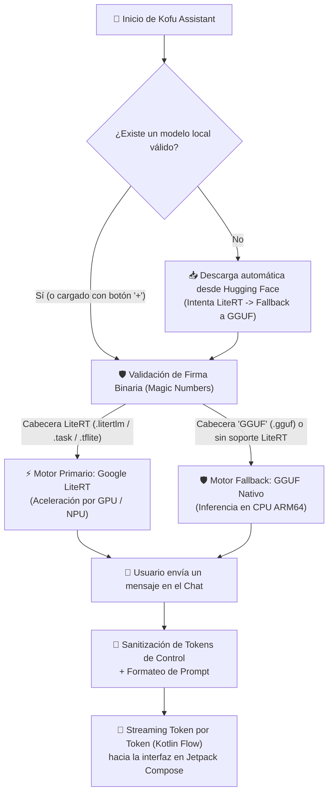

# Proyecto Kofu [Mobile] 🤖

<p align="center">
  
</p>

<p align="center">
  
  
  
  
  
  
  
  
</p>

---

## ⚡ ¿Qué es Kofu Mobile?

**Kofu Mobile** es un asistente de Inteligencia Artificial para Android diseñado para funcionar **100% dentro de tu teléfono**, sin servidores en la nube, sin cuentas de usuario y sin enviar tus conversaciones a internet.

En lugar de depender de APIs externas como ChatGPT o de instalar entornos Linux pesados (como Termux o PRoot), **Kofu ejecuta modelos de lenguaje compactos (de 1B a 2B de parámetros) directamente sobre el procesador, GPU o NPU de tu dispositivo**. Una vez descargado o importado el modelo, puedes conversar con Kofu incluso en **Modo Avión**.

---

## 🧠 ¿Cómo Funciona el Proyecto? (Explicación Paso a Paso)

El funcionamiento interno de Kofu se divide en **4 etapas claras** desde que abres la aplicación hasta que recibes una respuesta:



### 1. Obtención del Modelo (Automática o Manual)
Al abrir la aplicación por primera vez, [`LlamaRepository`](Kofu_Assistant/app/src/main/java/com/kofu/assistant/repository/LlamaRepository.kt) revisa el almacenamiento de la app:
* **Si ya tienes un modelo descargado**, lo carga de inmediato sin usar internet.
* **Si no hay ningún modelo**, inicia una descarga segura (HTTPS) desde Hugging Face mostrando una barra de progreso en la parte superior. Primero intenta obtener un paquete optimizado para **LiteRT** (`Gemma-2B-It-GPU-Int4.litertlm`) y, si no está disponible, descarga automáticamente el modelo universal **GGUF** (`Llama-3.2-1B-Instruct-Q4_K_M.gguf`).
* **Carga manual (Botón `+`):** En cualquier momento puedes tocar el icono **`+`** para seleccionar tu propio archivo `.litertlm`, `.task`, `.tflite` o `.gguf` guardado en tu teléfono.

### 2. Verificación de Seguridad Binaria (*Magic Numbers*)
Los modelos de IA pesan entre 700 MB y 2 GB. Si intentaras cargar un archivo corrupto o un archivo falso renombrado a `.gguf`, la memoria nativa colapsaría cerrando la aplicación. Para evitarlo, Kofu abre los primeros bytes del archivo y comprueba su firma interna antes de cargarlo:
* Para archivos **`.gguf`**, verifica que los primeros 4 bytes contengan exactamente la firma ASCII `GGUF`.
* Para archivos **`.litertlm` / `.task` / `.tflite`**, verifica que el tamaño sea válido y posea una cabecera `TFL3` o contenedor empaquetado `PK` de MediaPipe/LiteRT.

### 3. Arquitectura de Motor Dual (`LiteRT → GGUF Fallback`)
No todos los teléfonos Android tienen el mismo procesador ni los mismos drivers gráficos. Por ello, Kofu utiliza un **sistema de doble motor con respaldo automático**:

| Nivel | Motor de Inferencia | Formatos | ¿Cómo procesa la IA? | ¿Cuándo se activa? |
| :--- | :--- | :--- | :--- | :--- |
| **1.º Primario** | **Google LiteRT** *(AI Edge)* | `.litertlm`, `.task`, `.tflite`, `.bin` | Usa la **GPU / NPU** del teléfono para máxima velocidad y menor gasto de batería. | Al cargar un modelo LiteRT en un dispositivo compatible. |
| **2.º Respaldo** | **GGUF Fallback** *(llama.cpp / JNI)* | `.gguf` | Usa la **CPU de 64 bits (`arm64-v8a`)** mapeando el archivo directamente en RAM (`mmap`). | Automáticamente si el dispositivo no soporta LiteRT o al elegir un archivo `.gguf`. |

En la barra superior de la app verás siempre una etiqueta (**`⚡ LiteRT`** o **`🛡️ GGUF Fallback`**) que te indica qué motor está activo en tiempo real.

### 4. Conversación en Streaming y Protección de Prompts
Cuando escribes un mensaje y presionas enviar:
1. **Filtro anti-inyección:** Kofu limpia cualquier etiqueta reservada del sistema (como `<|eot_id|>` o `<|start_header_id|>`) para evitar que un texto pegado rompa el formato interno del modelo.
2. **Streaming reactivo:** La respuesta se genera y emite palabra por palabra mediante `Flow<String>` de Kotlin Coroutines, actualizando la burbuja de chat en vivo sin congelar la pantalla.

---

## 🗂️ Estructura del Código Fuente

El proyecto se ha mantenido intencionalmente **minimalista, limpio y libre de dependencias innecesarias**, concentrando toda su lógica en **4 archivos Kotlin principales**:

```text
Kofu_Mobile/
├── assets/
│   └── banner.jpeg                  # Banner oficial del repositorio (formato 4:3)
├── Kofu_Assistant/
│   └── app/
│       ├── build.gradle.kts         # Configuración ARM64, reglas noCompress (mmap) y dependencias
│       └── src/main/
│           ├── AndroidManifest.xml  # Permisos mínimos (solo INTERNET para descargar modelos)
│           ├── assets/
│           │   └── avatar_kofu.png  # Ilustración transparente de Kofu mostrada en la interfaz
│           ├── res/xml/
│           │   └── network_security_config.xml # Bloqueo de tráfico HTTP plano; solo HTTPS a Hugging Face
│           └── java/com/kofu/assistant/
│               ├── MainActivity.kt             # Punto de entrada y persistencia del tema (Claro/Oscuro/Sistema)
│               ├── repository/
│               │   └── LlamaRepository.kt      # Descarga de modelos, validación Magic Numbers y motor LiteRT -> GGUF
│               └── ui/
│                   ├── ChatScreen.kt           # Interfaz de chat, chips de sugerencias, selector de modelos y diagnóstico
│                   └── theme/
│                       └── KofuTheme.kt        # Paletas de color KofuColors y soporte de temas dinámicos
├── LICENSE                          # Licencia MIT
└── README.md                        # Documentación del proyecto
```

---

## ✨ Características Destacadas

* 🔒 **Privacidad Real y Cero Telemetría:** Sin rastreadores, sin analíticas y con copias de seguridad automáticas desactivadas (`allowBackup="false"`) para proteger tus conversaciones locales.
* ⚡ **Mapeo en Memoria sin Compresión (`Zero-Copy mmap`):** El archivo `build.gradle.kts` configura AAPT2 para no comprimir extensiones `.litertlm`, `.tflite`, `.task`, `.gguf` ni `.bin`, permitiendo leer los pesos directamente sin duplicar el consumo de RAM.
* 🌓 **3 Modos Visuales Definibles:** Puedes alternar en cualquier momento entre **☀️ Modo Claro**, **🌙 Modo Oscuro** y **⚙️ Automático (Sistema)** desde el botón superior; tu elección se guarda automáticamente.
* 🩺 **Panel de Diagnóstico Integrado:** Desde el menú superior (`⋮` → *Estado del Motor / Acerca de Kofu*) puedes inspeccionar qué backend está activo y qué archivo de modelo está cargado en memoria.

---

## 📱 Requisitos del Dispositivo

| Componente | Mínimo | Recomendado |
| :--- | :--- | :--- |
| **Versión de Android** | Android 8.0 (Oreo / API 26) | Android 12 o superior (API 31+) |
| **Procesador (ABI)** | ARM64-v8a (64 bits) | Snapdragon serie 7/8, Google Tensor o MediaTek Dimensity |
| **Memoria RAM** | **6 GB de RAM física** | **8 GB+ de RAM física** |
| **Almacenamiento Libre** | 2 GB libres | 4 GB libres (si deseas probar varios modelos) |
| **Conexión a Internet** | Solo la primera vez para descargar el modelo (opcional si cargas uno propio con `+`) | No requiere internet para chatear |

---

## 🚀 Guía de Uso Rápido

1. **Instala y abre Kofu Assistant** en tu teléfono Android.
2. **Espera la descarga inicial** (verás el porcentaje de avance en el encabezado) **o toca el botón `+`** en la esquina superior derecha para seleccionar un archivo `.litertlm`, `.task` o `.gguf` que ya tengas en tu carpeta de *Descargas*.
3. Verifica que el indicador cambie a **`⚡ LiteRT`** o **`🛡️ GGUF Fallback`** con el mensaje *"Modelo listo"*.
4. **Toca cualquiera de las sugerencias rápidas** o escribe tu pregunta en la barra inferior para comenzar a conversar.

---

## 🛠️ Compilación desde el Código Fuente (Desarrolladores)

1. Clona el repositorio:
   ```bash
   git clone https://github.com/Kineyo/Kofu_Mobile.git
   cd Kofu_Mobile/Kofu_Assistant
   ```
2. Abre la carpeta `Kofu_Assistant` en **Android Studio** (con **JDK 17** y **Android SDK 34**).
3. Para compilar el APK de prueba desde la terminal:
   ```bash
   ./gradlew assembleDebug
   ```
   El instalador se generará en `app/build/outputs/apk/debug/app-debug.apk`.

---

## 📄 Licencia

Distribuido bajo la licencia **MIT**. Consulta el archivo [`LICENSE`](LICENSE) para más información.
