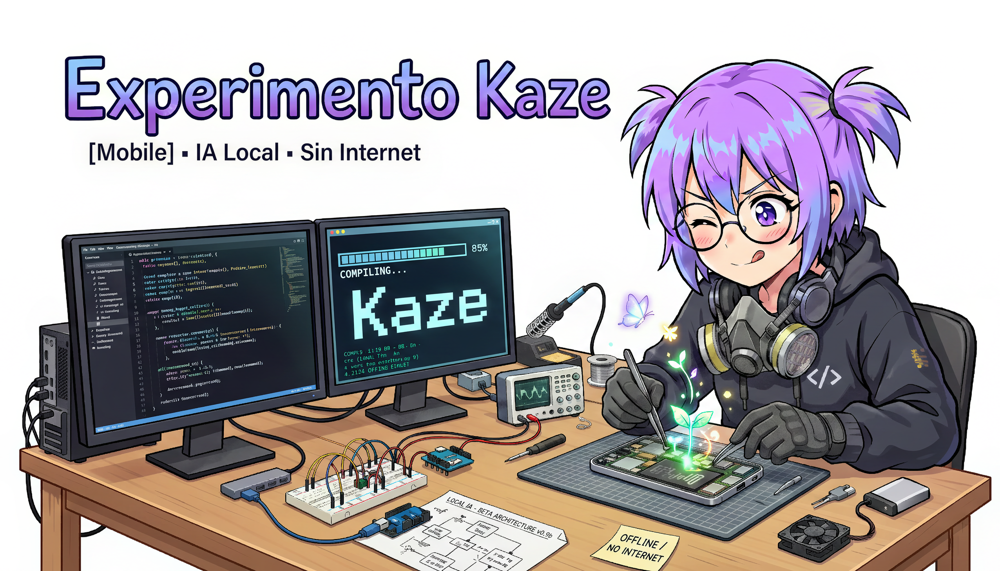
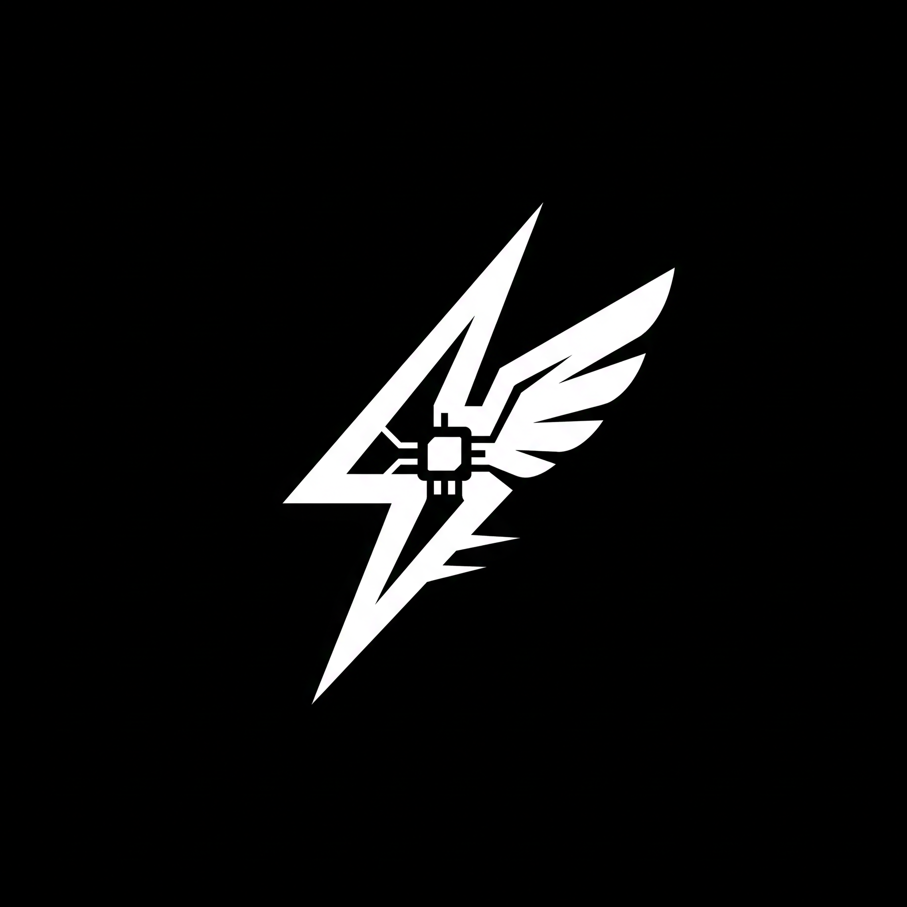

# ☢️ Aura-Kaze [Rama Experimental `dev-test`]

<p align="center">
  
</p>

<p align="center">
  
</p>

<p align="center">
  
  
  
  
  
</p>

---

> [!CAUTION]
> **RAMA EXPERIMENTAL (`dev-test`) — ALTO RIESGO TÉRMICO Y DE I/O**
> Esta rama es una **beta experimental 100% inflamable** creada para probar el motor híbrido universal de paginación MoE sobre almacenamiento directo **UFS** (inspirado en el patrón *Hot/Warm/Cold* de Colibri, escrito desde cero en C++20 bajo licencia MIT).
> - Usa `applicationIdSuffix = ".devtest"`, por lo que **se instala aparte** de tu versión estable (`main` / `kofu-go`) sin sobrescribir tus chats.
> - Incluye un **Gobernador Térmico y de RAM** (*Anti-Chernobyl*) que recorta la caché Warm y aplica enfriamiento por token si sube la temperatura o `VmRSS`.

---

## 🧠 ¿Qué es la rama `dev-test`?

`dev-test` fusiona los 3 perfiles de silicio de `main` (`node7nm`, `node5nm`, `frontierSub5nm`) con el presupuesto estricto `<= 2 GB` y el motor RAG de `kofu-go`, eliminando **el 100% de la dependencia de Google Gemma** y sus términos de uso restrictivos.

En su lugar, adopta la familia propia **100% MIT**:
1. **Cerebro Base (`Kaze-4.7B-A530M`):** Sparse Mixture-of-Experts (`1 Shared Expert + 31 Routed Experts`, Top-2 activos = `528M` parámetros activos por token).
2. **Sub-modelo Exprimido (`Aura-Kaze-Go 1.1B`):** Rama podada (*Task-Specific Expert Pruning*, 5–7 expertos) dedicada a teléfonos con `<= 3 GB RAM` o almacenamiento lento **eMMC**.

---

## 🔗 Enlaces a los Cerebros en Hugging Face (100% MIT)

| Modelo | Arquitectura | Cuantización | Peso en Disco | Uso en `dev-test` | Repositorio Hugging Face |
| :--- | :--- | :--- | :--- | :--- | :--- |
| **`Kaze-4.7B-A530M` (Base)** | 1 Shared + 31 Routed (Top-2, 528M activos) | `Q4_K_M` | **~2.75 GB** *(en UFS)* | Teléfonos `4–12 GB+` con **UFS rápido (`>= 600 MB/s`)** usando paginación Hot/Warm/Cold (`~1.1 GB RAM`) | [`shebxyd/kaze-4.7b-a530m-edge`](https://huggingface.co/shebxyd/kaze-4.7b-a530m-edge) |
| **`Aura-Kaze-Go 1.1B` (Podado)** | 1 Shared + 5–7 Routed (Top-2) | `Q4_K_M` / `IQ3_XS` | **~550–660 MB** | Teléfonos **`<= 3 GB RAM`** o almacenamiento **eMMC lento (`< 600 MB/s`)** 100% en RAM/`mmap` | [`shebxyd/aura-kaze-go-edge`](https://huggingface.co/shebxyd/aura-kaze-go-edge) |
| **Micro-Embedder RAG** | `all-MiniLM-L6-v2` | `Q8_0` | **~24 MB** | Opcional para búsqueda semántica `int8` NEON (respaldo 100% MIT `SQLite FTS4 + BM25` sin embedder) | [`second-state/All-MiniLM-L6-v2-Embedding-GGUF`](https://huggingface.co/second-state/All-MiniLM-L6-v2-Embedding-GGUF) |

---

## 🏛️ Cómo funciona la Arquitectura Híbrida UFS MoE (Hot / Warm / Cold)

En lugar de mandar pesos cuantizados a **ZRAM/Swap** (lo cual falla en Android porque `Q4_K_M` es casi incompresible y termina ocupando la misma RAM física), `dev-test` implementa [`MoeUfsPager`](Kofu_Assistant/app/src/main/cpp/include/moe_ufs_pager.hpp) en C++20 puro:

```text
┌─────────────────────────────────────────────────────────────────────────┐
│             SONDA AUTOMÁTICA AL ARRANCAR (RAM + UFS vs eMMC)            │
│   nativeProbeUfsStorage(filesDir) -> mide lectura real de 16 MB (MB/s)  │
└───────────────┬─────────────────────────────────────────┬───────────────┘
                │ >= 600 MB/s (UFS) & > 3.4 GB RAM        │ < 600 MB/s (eMMC) o <= 3 GB RAM
                ▼                                         ▼
┌─────────────────────────────────────────┐  ┌────────────────────────────┐
│  MODO UFS_HIERARCHICAL (Kaze-4.7B Base) │  │  MODO RAM_RESIDENT_PRUNED  │
│  ┌───────────────────────────────────┐  │  │  (Aura-Kaze-Go 1.1B ~660MB)│
│  │ HOT (Fijo en GPU/RAM ~240 MB)     │  │  │  - 5-7 expertos podados    │
│  │ Embeddings + GQA + Shared Expert  │  │  │  - 100% residente en RAM   │
│  ├───────────────────────────────────┤  │  │  - Cero cuello de disco    │
│  │ WARM (Caché LRU en RAM 256-768MB) │  │  │  - Techo VmRSS <= 1850 MB  │
│  │ ~150-200 expertos más recientes   │  │  └────────────────────────────┘
│  ├───────────────────────────────────┤  │
│  │ COLD (Almacenamiento privado UFS) │  │
│  │ pread() directo + FADV_DONTNEED   │  │
│  │ (sin inflar Page Cache ni ZRAM)   │  │
│  └───────────────────────────────────┘  │
└───────────────────┬─────────────────────┘
                    ▼
┌─────────────────────────────────────────────────────────────────────────┐
│     CASCADA DE HARDWARE (GPU -> NPU -> CPU) + GOBERNADOR TÉRMICO/RAM    │
│  - nativeUpdateThermalStatus(): encoge Warm LRU y aplica cooling delay  │
│  - LMK Guard cada 8 tokens (VmRSS <= 1850 MB, KV Cache Q8_0/Q8_0)       │
│  - RAG Híbrido (SQLite FTS4 + BM25) + HallucinationGuard                │
└─────────────────────────────────────────────────────────────────────────┘
```

### Componentes clave añadidos en `dev-test`
- **[`moe_ufs_pager.hpp`](Kofu_Assistant/app/src/main/cpp/include/moe_ufs_pager.hpp) / [`moe_ufs_pager.cpp`](Kofu_Assistant/app/src/main/cpp/src/moe_ufs_pager.cpp):** Paginador jerárquico Hot/Warm/Cold (O(1) LRU + `pread()` + `posix_fadvise(POSIX_FADV_DONTNEED)` alineado a 16 KB) + sonda de ancho de banda UFS + gobernador térmico/RAM.
- **[`KofuEditionProfile.kt`](Kofu_Assistant/app/src/main/java/com/kofu/assistant/data/KofuEditionProfile.kt):** Enrutamiento adaptable que combina `deviceTotalRamMb` y `storageBandwidthMbps` para escoger entre `Kaze-4.7B-A530M` y `Aura-Kaze-Go 1.1B`.
- **[`LlamaRepository.kt`](Kofu_Assistant/app/src/main/java/com/kofu/assistant/repository/LlamaRepository.kt):** Catálogo 100% libre de Google Gemma + inicialización de la sonda UFS en segundo plano (`probeUfsAndConfigurePager`).
- **[`dev-test-beta.yml`](.github/workflows/dev-test-beta.yml):** Pipeline de GitHub Actions que ejecuta pruebas unitarias y compila automáticamente los 3 sabores (`7nm`, `5nm`, `frontier`) con `SHA256SUMS.txt` y opción de Pre-Release.

---

## 📱 Requerimientos del Dispositivo

| Perfil | RAM Física | Almacenamiento | Modelo Asignado | Android / ISA |
| :--- | :--- | :--- | :--- | :--- |
| **Gama Entrada (`node7nm`)** | `3 GB` | eMMC 5.1 (`< 600 MB/s`) o 1.5 GB libres | `Aura-Kaze-Go 1.1B` (`~660 MB`) | Android 5.0+ (`armv8-a`) |
| **Gama Media UFS (`node5nm`)** | `4–8 GB` | **UFS 2.2 / 3.1 / 4.0** (`>= 600 MB/s`, 4 GB libres) | `Kaze-4.7B-A530M` (Hot/Warm/Cold UFS) | Android 8.0+ (`armv8.2-a+dotprod+fp16`) |
| **Flagship (`frontierSub5nm`)** | `12 GB+` | **UFS 3.1 / 4.0** (4 GB libres) | `Kaze-4.7B-A530M` Full (`Warm 768 MB+`) | Android 14+ (`armv8.6-a+dotprod+fp16+i8mm`) |

---

## 🛠️ Compilación Local y GitHub Actions

### GitHub Actions (Automático en `dev-test` y Manual)
El workflow [`.github/workflows/dev-test-beta.yml`](.github/workflows/dev-test-beta.yml) se ejecuta en cada `push` a `dev-test` o manualmente desde la pestaña **Actions** (con checkbox opcional para publicar como **GitHub Pre-Release**). Genera 4 APKs firmados + `SHA256SUMS.txt`:
- `Aura-Kaze-devtest-<sha>-7nm-arm64-release.apk`
- `Aura-Kaze-devtest-<sha>-5nm-ufs-arm64-release.apk`
- `Aura-Kaze-devtest-<sha>-5nm-ufs-arm64-debug.apk`
- `Aura-Kaze-devtest-<sha>-frontier-arm64-release.apk`

### Compilación Manual
```bash
cd Kofu_Assistant
./gradlew testNode7nmDebugUnitTest testNode5nmDebugUnitTest
./gradlew assembleNode5nmRelease assembleNode7nmRelease assembleFrontierSub5nmRelease
```

---

## 📄 Licencia
Todo el código de `Aura-Kaze` (`dev-test`), el paginador `MoeUfsPager` y la familia de pesos **`Kaze-4.7B-A530M` / `Aura-Kaze-Go`** están bajo licencia **MIT** (sin dependencias de Google Gemma).
