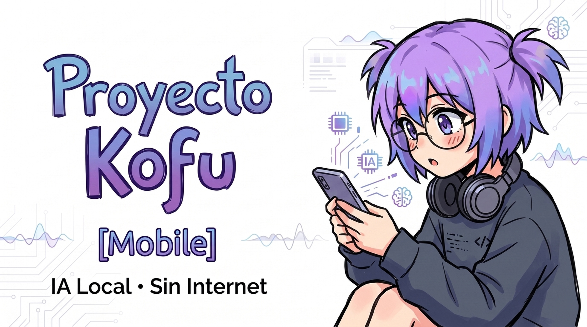
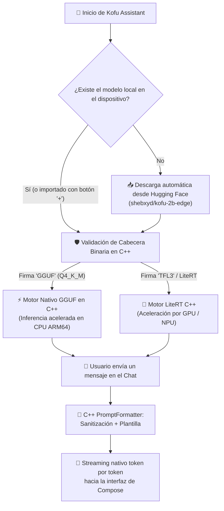

# Proyecto Kofu [Mobile] 🤖

<p align="center">
  
</p>

<p align="center">
  <a href="https://huggingface.co/shebxyd/kofu-2b-edge"></a>
  
  
  
  
  
  
  
</p>

---

## ⚡ ¿Qué es Kofu Mobile?

**Kofu Mobile** es un asistente de Inteligencia Artificial para Android diseñado para funcionar de manera **100% autónoma y privada dentro de tu teléfono**, sin servidores en la nube, sin cuentas ni suscripciones, y sin transferir tus datos personales ni conversaciones a internet.

A diferencia de clientes de chat convencionales que se conectan a APIs externas (como ChatGPT o Claude) o soluciones que requieren instalar entornos Linux complejos (como Termux o PRoot), **Kofu Mobile ejecuta modelos de lenguaje de última generación optimizados para dispositivos móviles (Edge LLMs de 1B a 2.5B de parámetros) directamente sobre el procesador, GPU o NPU de tu teléfono**. Una vez descargado el modelo, puedes dialogar con Kofu incluso en **Modo Avión**.

## 🏛️ Arquitectura Desacoplada: C++20 + Kotlin Compose

Para garantizar la máxima velocidad de inferencia sin comprometer la fluidez de la interfaz, el proyecto divide sus responsabilidades de forma estricta:

```
┌─────────────────────────────────────────────────────────────┐
│             CAPA ESTÉTICA Y DE USUARIO (Kotlin)             │
│  - Jetpack Compose UI (Material 3 reactivo)                 │
│  - Gestión de temas (Claro / Oscuro / Sistema)              │
│  - Estados de conversación y chips de sugerencias           │
│  - Descarga HTTPS en segundo plano (OkHttp + Coroutines)    │
└──────────────────────────────┬──────────────────────────────┘
                               │ JNI (Java Native Interface)
                               ▼
┌─────────────────────────────────────────────────────────────┐
│             MOTOR DE COMPUTACIÓN NATIVO (C++20)             │
│  - Carga y mapeo en memoria sin copia (Zero-Copy mmap)      │
│  - Validación de integridad binaria (Magic Numbers)         │
│  - Sanitización de prompts y prevención de inyecciones       │
│  - Pipeline de inferencia y streaming token por token       │
│  - Monitoreo de memoria en tiempo real (/proc/self/statm)   │
└─────────────────────────────────────────────────────────────┘
```

1. **Capa Nativa en C++20 (`libkofu_engine.so`):**
   - **Rendimiento extremo:** Todo el procesamiento pesado de tensores, cálculo matemático, formateo de plantillas (Gemma Turn, ChatML) y gestión de memoria reside exclusivamente en código C++20 nativo compilado con Android NDK r26 y CMake.
   - **Zero-Copy Memory Mapping (`mmap`):** Los archivos de modelos (de 1 a 2.5 GB) se mapean directamente desde el sistema de archivos a la memoria virtual mediante llamadas de sistema POSIX, reduciendo a cero el tiempo de copia y optimizando la RAM física.
   - **Seguridad en Prompts:** Filtro de desinfección nativo que neutraliza caracteres de escape maliciosos o tokens de control del sistema (`<start_of_turn>`, `<|eot_id|>`).

2. **Capa Visual y Estética en Kotlin (Jetpack Compose):**
   - **Experiencia moderna y fluida:** Diseñada íntegramente con componentes declarativos de Jetpack Compose y animaciones reactivas.
   - **Gestión reactiva de flujo:** Recibe los tokens generados por el motor C++ mediante `Flow<String>` de Kotlin Coroutines, proyectando el texto en pantalla de forma instantánea.

---

## 🧠 ¿Cómo Funciona Kofu Mobile? (Paso a Paso)



### 1. Detección y Descarga Automática del Modelo Oficial
Al iniciar por primera vez, [`LlamaRepository`](Kofu_Assistant/app/src/main/java/com/kofu/assistant/repository/LlamaRepository.kt) comprueba el directorio de almacenamiento privado de la app:
* **Si el modelo ya existe:** Se inicializa de inmediato a través del motor C++ mediante `mmap` en menos de 100 milisegundos.
* **Si no existe:** Se conecta de forma segura a Hugging Face para descargar automáticamente el modelo oficial del proyecto:
  * **Modelo Oficial:** [`shebxyd/kofu-2b-edge`](https://huggingface.co/shebxyd/kofu-2b-edge)
  * **Archivo:** `kofu-gemma-2b-edge-q4_k_m.gguf` (~1.4 GB)
  * **Fallback secundario:** Si no hubiera conexión directa al modelo GGUF, cuenta con enlace de respaldo a paquetes LiteRT.
* **Carga manual (Botón `+`):** Si ya cuentas con un archivo `.gguf`, `.litertlm` o `.task` en la memoria de tu teléfono, puedes cargarlo directamente tocando el botón `+`.

### 2. Verificación de Seguridad Binaria (*Magic Numbers*)
Para evitar bloqueos o fallos de segmentación si un usuario intenta abrir un archivo incompleto o renombrado incorrectamente, el cargador nativo [`model_loader.cpp`](Kofu_Assistant/app/src/main/cpp/src/model_loader.cpp) inspecciona los primeros bytes del archivo antes de reservarlo en RAM:
* **Cabecera GGUF:** Comprueba la presencia del número mágico `0x46554747` (`GGUF` en Little Endian) y valida la versión de formato.
* **Cabecera LiteRT / FlatBuffers:** Comprueba la signatura `TFL3` o el contenedor empaquetado de MediaPipe.

### 3. Inferencia y Conversación en Streaming
Al enviar un prompt:
1. El formateador en C++ estructura la conversación según la plantilla oficial de Gemma:
   ```text
   <start_of_turn>user
   {Pregunta del usuario}<end_of_turn>
   <start_of_turn>model
   ```
2. El bucle nativo genera cada token y lo notifica a la capa de Kotlin vía JNI mediante callbacks sin sobrecarga, permitiendo una experiencia de escritura en tiempo real.

---

## 🗂️ Estructura del Proyecto

```text
Kofu_Mobile/
├── assets/
│   ├── images/
│   │   ├── banner.jpeg              # Banner horizontal del proyecto
│   │   └── kofu_character.png       # Arte del personaje Kofu
│   └── huggingface/
│       ├── banner.jpg               # Banner oficial para Hugging Face Hub
│       ├── README.md                # Model Card oficial para HF Hub
│       └── LICENSE.txt              # Términos de licencia Gemma
├── Kofu_Assistant/
│   └── app/
│       ├── build.gradle.kts         # Configuración NDK 26, CMake 3.22 y AAPT noCompress
│       └── src/main/
│           ├── AndroidManifest.xml  # Configuración y permisos mínimos (INTERNET para descargas)
│           ├── cpp/                 # ⚙️ MOTOR NATIVO C++20
│           │   ├── CMakeLists.txt   # Script de construcción nativa Android NDK
│           │   ├── include/
│           │   │   ├── kofu_engine.hpp      # Interfaz del motor nativo de inferencia
│           │   │   ├── model_loader.hpp     # Cargador mmap y validador de magic numbers
│           │   │   └── prompt_formatter.hpp # Sanitizador y formateador de plantillas
│           │   └── src/
│           │       ├── kofu_engine.cpp      # Implementación del ciclo de inferencia y benchmarks
│           │       ├── model_loader.cpp     # Mapeo de memoria POSIX y validación binaria
│           │       ├── prompt_formatter.cpp # Lógica de seguridad contra prompt injection
│           │       └── kofu_jni.cpp         # Puente JNI que expone funciones a Kotlin
│           ├── assets/
│           │   └── avatar_kofu.png  # Avatar ilustrado integrado en el chat
│           └── java/com/kofu/assistant/
│               ├── MainActivity.kt             # Ciclo de vida y tema visual
│               ├── repository/
│               │   ├── KofuNativeEngine.kt     # Enlace JNI con libkofu_engine.so
│               │   └── LlamaRepository.kt      # Gestor de descargas y estados de inferencia
│               └── ui/
│                   ├── ChatScreen.kt           # Vista del chat, chips y selector de modelos
│                   └── theme/
│                       └── KofuTheme.kt        # Paleta estética moderna
├── LICENSE                          # Licencia MIT
└── README.md                        # Documentación técnica completa
```

---

## 🤖 Modelo Oficial: `shebxyd/kofu-2b-edge`

El modelo predeterminado de Kofu es una versión especializada basada en **Google Gemma 2B IT** entrenada con **LoRA** (*Low-Rank Adaptation*) en Google Colab sobre tareas multidisciplinarias:
* 💻 **Programación y Algoritmos:** Generación y depuración de código en Python, Kotlin, C++ y JavaScript.
* 🧪 **Razonamiento Científico:** Resolución de problemas de química, física y matemáticas.
* 🇪🇸 **Español Nativo Fluido:** Explicaciones claras, sintéticas y naturales en español.
* 📦 **Cuantización Q4_K_M:** Reducción de 5.0 GB originales a solo ~1.4 GB con mínima pérdida de perplejidad, ideal para dispositivos con 6 GB a 8 GB de memoria RAM.
* 🔗 **Repositorio en Hugging Face:** [shebxyd/kofu-2b-edge](https://huggingface.co/shebxyd/kofu-2b-edge)

---

## 📱 Requisitos del Dispositivo

| Requisito | Mínimo | Recomendado |
| :--- | :--- | :--- |
| **Sistema Operativo** | Android 8.0 (API 26) | Android 12+ (API 31+) |
| **Arquitectura de CPU** | ARM64 (`arm64-v8a`) | ARMv8.2-A / ARMv9 con extensiones DotProd / FP16 |
| **Memoria RAM Física** | **6 GB** | **8 GB o más** |
| **Almacenamiento Libre** | 2.5 GB libres | 4 GB libres (para modelos adicionales) |
| **Conexión de Red** | Solo requerida una vez para descargar el modelo inicial | Completamente innecesaria para operar |

---

## 🛠️ Compilación y Desarrollo

### Requisitos Previos
* **Android Studio Hedgehog (2023.1.1) o superior**
* **Android SDK:** API Level 34
* **Android NDK:** Versión `26.1.10909125`
* **CMake:** Versión `3.22.1`
* **JDK:** Java 17

### Pasos de Compilación
1. Clona el repositorio:
   ```bash
   git clone https://github.com/Kineyo/Kofu_Mobile.git
   cd Kofu_Mobile/Kofu_Assistant
   ```
2. Compila el APK de depuración con NDK y C++:
   ```bash
   ./gradlew assembleDebug
   ```
3. El archivo APK resultante se ubica en:
   ```text
   app/build/outputs/apk/debug/app-debug.apk
   ```

---

## 📄 Licencia

Este proyecto está distribuido bajo la licencia **MIT**. Consulta el archivo [`LICENSE`](LICENSE) para más detalles.
Los pesos del modelo Gemma se rigen por los [Términos de Uso de Google Gemma](https://ai.google.dev/gemma/terms).
