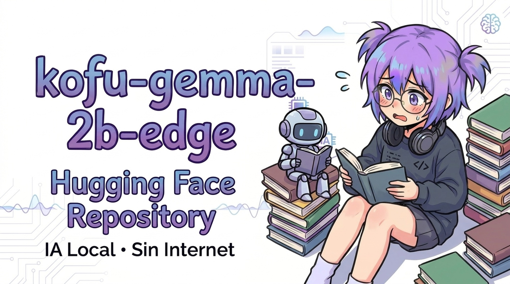

<div align="center">
  

  # Kofu 2.0 Edge (IA Local • On-Device)
  ### *Modelo derivado de última generación basado en Google Gemma 2 2B Instruct*

  [](https://ai.google.dev/gemma/terms)
  [](https://huggingface.co/google/gemma-2-2b-it)
  [](https://github.com/Kineyo/Kofu_Mobile)
  [](https://github.com/Kineyo/Kofu_Mobile)
</div>

---

## 📌 Resumen de Kofu 2.0

**`kofu-v2-edge`** es la segunda generación del modelo conversacional e instruccional ligero del ecosistema [**Kofu Mobile**](https://github.com/Kineyo/Kofu_Mobile). Construido sobre la avanzada arquitectura **Gemma 2 (2B)** de Google DeepMind, ofrece un salto sustancial en precisión sintáctica, lógica de programación, razonamiento matemático y fluidez en español, manteniendo una huella de memoria optimizada para ejecutarse **100% on-device y sin internet** en teléfonos móviles y dispositivos embebidos ARM64.

- **Desarrollador / Creador:** alex minerva ([@shebxyd](https://huggingface.co/shebxyd))
- **Modelo Base:** [google/gemma-2-2b-it](https://huggingface.co/google/gemma-2-2b-it) (Google LLC)
- **Tipo de Modelo:** Causal LM decoder-only basado en arquitectura Gemma 2
- **Licencia:** [Gemma Terms of Use](https://ai.google.dev/gemma/terms)
- **Idiomas:** Español (`es`), Inglés (`en`)

---

## ⚖️ Declaración de Cumplimiento de Normas Gemma (Gemma Terms of Use)

De acuerdo con la sección 3 de los **Términos de Uso de Gemma**:

1. **Aviso de Modificación (Notice of Modifications):**
   Este modelo es un **trabajo derivado (Model Derivative)** que modifica el modelo base oficial `google/gemma-2-2b-it` de Google LLC mediante:
   - Adaptación de bajo rango (**LoRA** - Low-Rank Adaptation) con $r=16, \alpha=32$ sobre los módulos de atención y proyección (`q_proj`, `k_proj`, `v_proj`, `o_proj`, `gate_proj`, `up_proj`, `down_proj`).
   - Ventana de contexto ampliada a 512 tokens con empaquetado secuencial.
   - Fusión completa de pesos en formato SafeTensors.
   - Cuantización a formato GGUF de 4 bits (`Q4_K_M`) para inferencia ultra-eficiente en dispositivos móviles con memoria limitada (< 2.5 GB RAM).

2. **Atribución de Marcas:**
   *Gemma is a trademark of Google LLC.*  
   Este proyecto es un desarrollo independiente de alex minerva (`shebxyd`) y **no está afiliado, patrocinado ni respaldado por Google LLC**.

3. **Política de Uso Prohibido:**
   El uso, distribución y derivación de este modelo está estrictamente condicionado al cumplimiento de la **[Política de Uso Prohibido de IA Generativa de Google](https://policies.google.com/terms/generative-ai/use-policy)**.

---

## 🎯 Especialización y Capacidades en v2.0

El entrenamiento integró 4,800 ejemplos equilibrados y filtrados en 4 pilares:
1. **Lógica de Programación y Algoritmos:** C++, Java, Kotlin, Python, Web y resolución algorítmica paso a paso.
2. **Ciberseguridad Defensiva y Principios Éticos:** Explicación conceptual de vulnerabilidades y buenas prácticas de mitigación y seguridad en redes.
3. **Razonamiento Multidisciplinario en Español:** Matemáticas, ciencias, historia y ética formativa.
4. **Respuestas Concisas y Amables:** Optimizado para interfaces móviles conversacionales con baja latencia y consumo reducido de batería.

---

## 📦 Archivos Disponibles en este Repositorio

| Archivo | Formato | Tamaño | Descripción y Uso Recomendado |
| :--- | :---: | :---: | :--- |
| `kofu-v2-edge-q4_k_m.gguf` | **GGUF** (Q4_K_M) | **~1.6 GB** | **(Recomendado para Móvil)** Ejecución directa en teléfonos (RAM < 2.5 GB). Formato predeterminado de Kofu Mobile v2.0. |
| `model.safetensors` | **Safetensors** (BF16) | **~5.2 GB** | Pesos completos fusionados (Merged Base + LoRA) para servidores, fine-tuning adicional o conversión. |
| `NOTICE` | Texto | < 1 KB | Archivo de aviso formal requerido por los Términos de Uso de Gemma. |
| `LICENSE` | Texto | < 2 KB | Términos de uso y condiciones de licencia Gemma de Google. |
| `tokenizer.json` / `tokenizer_config.json` | Tokenizer | ~17 MB | Tokenizer nativo de Gemma 2 con vocabulario completo de 256k tokens. |
| `config.json` | Config | < 1 KB | Configuración de arquitectura Gemma 2 CausalLM. |

---

## ⚡ Formato del Prompt (Gemma Turn Format)

El modelo preserva el formato oficial de turnos de diálogo de Gemma:

```text
<start_of_turn>user
Hola Kofu, ¿puedes explicarme cómo funciona un apuntador en C++?<end_of_turn>
<start_of_turn>model
¡Hola! Con gusto te explico: un apuntador en C++ es una variable que almacena la dirección de memoria de otra variable...<end_of_turn>
```

---

## 🚀 Cómo Usar este Modelo

### 1. En la Aplicación Kofu Mobile (Android)
El modelo está integrado en la aplicación móvil [Kofu Mobile v2.0](https://github.com/Kineyo/Kofu_Mobile).
1. Abre la app en tu teléfono Android.
2. El motor nativo en C++ descargará automáticamente `kofu-v2-edge-q4_k_m.gguf` directamente desde este repositorio.
3. Puedes conversar de forma privada, segura y offline con memoria multi-turno completa.

### 2. Con `llama.cpp` (Terminal / Local)
```bash
./llama-cli -m kofu-v2-edge-q4_k_m.gguf \
    -p "<start_of_turn>user\nExplica qué es un puntero en C++<end_of_turn>\n<start_of_turn>model\n" \
    -n 256 --color -c 2048
```

### 3. Con Python (`transformers`)
```python
import torch
from transformers import AutoTokenizer, AutoModelForCausalLM

model_id = "shebxyd/kofu-v2-edge"

tokenizer = AutoTokenizer.from_pretrained(model_id)
model = AutoModelForCausalLM.from_pretrained(
    model_id,
    torch_dtype=torch.bfloat16,
    device_map="auto"
)

prompt = "<start_of_turn>user\n¿Cuál es la diferencia entre stack y heap?<end_of_turn>\n<start_of_turn>model\n"
inputs = tokenizer(prompt, return_tensors="pt").to(model.device)

outputs = model.generate(**inputs, max_new_tokens=200, temperature=0.7)
print(tokenizer.decode(outputs[0], skip_special_tokens=False))
```

---

## 📊 Detalles del Entrenamiento v2.0

- **Base Model:** `google/gemma-2-2b-it` (Gemma 2)
- **Método:** LoRA (Low-Rank Adaptation)
  - Rank ($r$): `16`
  - Alpha ($\alpha$): `32`
  - Target Modules: `q_proj`, `k_proj`, `v_proj`, `o_proj`, `gate_proj`, `up_proj`, `down_proj`
  - Dropout: `0.05`
- **Longitud Máxima de Contexto:** `512` tokens
- **Hardware de Entrenamiento:** GPU NVIDIA Tesla T4 (Google Colab)
- **Batch Size Efectivo:** `16` (batch per device: 1, gradient accumulation: 16)
- **Optimizador:** `AdamW` (learning rate: `2e-4`, cosine schedule, warmup_steps: 15)
- **Datasets Utilizados:**
  - `plncmm/spanish-alpaca`
  - `Yahir/alpaca-logica-programacion`
  - `sahil2801/CodeAlpaca-20k`
  - `murdok1982/gemma4-programacion-seguridad`

---

## ⚠️ Limitaciones y Consideraciones Éticas

- **Tamaño del Modelo (2B):** Como modelo de 2 mil millones de parámetros, puede presentar alucinaciones o imprecisiones en tareas de razonamiento extremo o conocimiento altamente especializado.
- **Verificación de Código:** Todo código generado debe ser revisado y probado en entornos controlados antes de su despliegue en producción.
- **Usos Prohibidos:** Está estrictamente prohibido utilizar este modelo para la generación de malware, explotación de vulnerabilidades sin autorización, vigilancia masiva, suplantación de identidad o cualquier actividad que contravenga las políticas de uso ético de Google y las leyes locales.

---

## 📜 Licencia y Términos

Este modelo se distribuye bajo los términos de la **[Licencia Gemma de Google (Gemma Terms of Use)](https://ai.google.dev/gemma/terms)**.
Consulte los archivos [`LICENSE`](./LICENSE) y [`NOTICE`](./NOTICE) incluidos en la raíz del repositorio.
